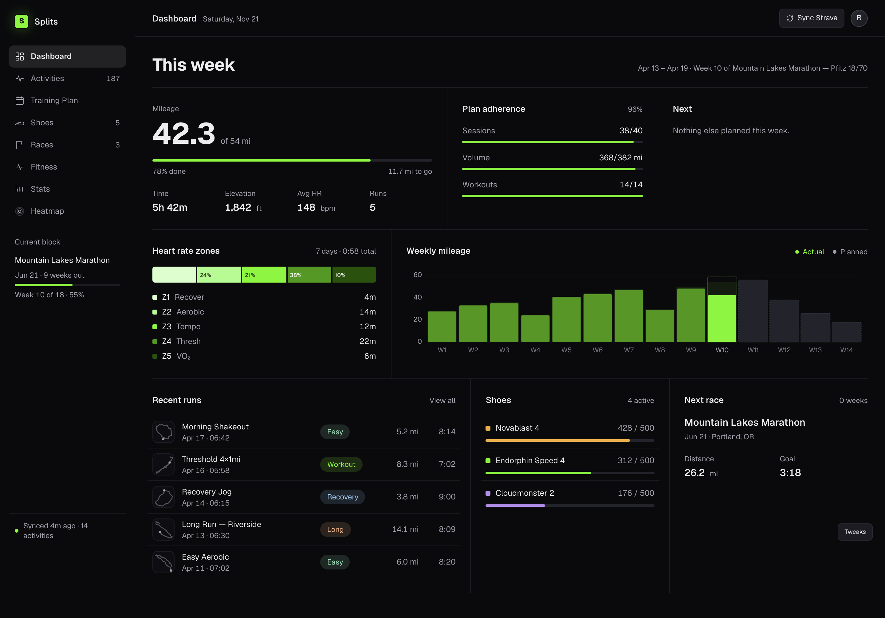
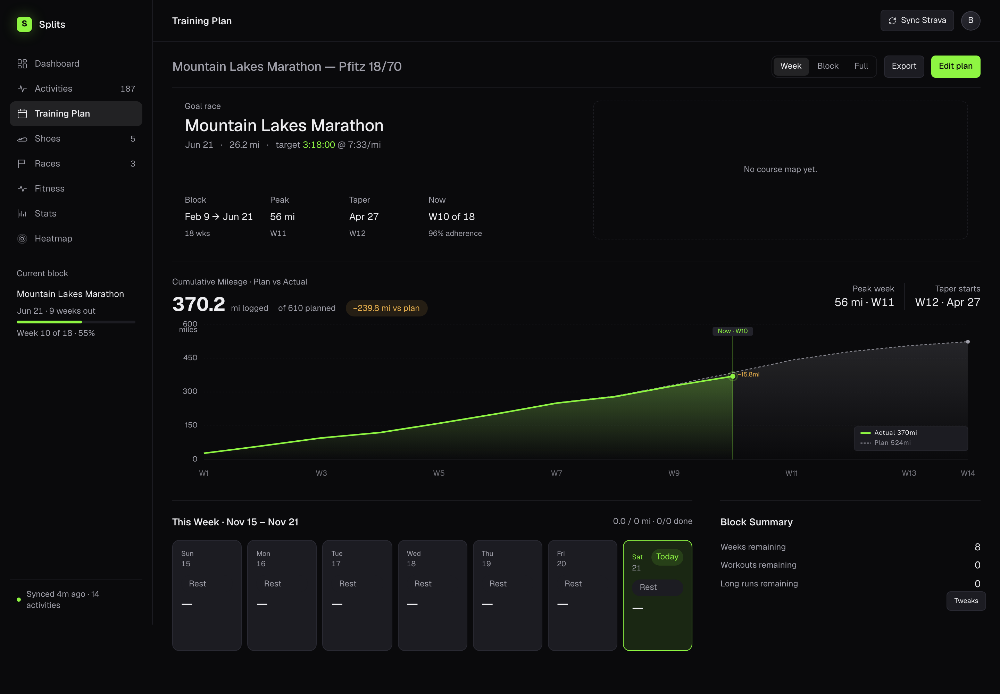
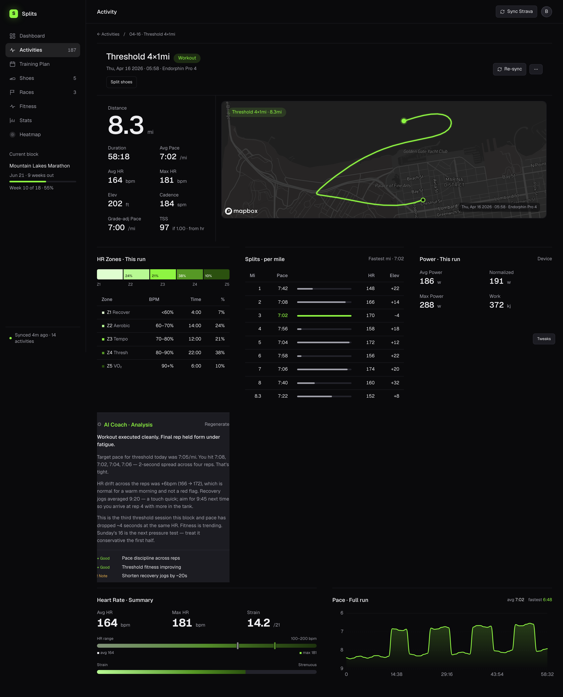
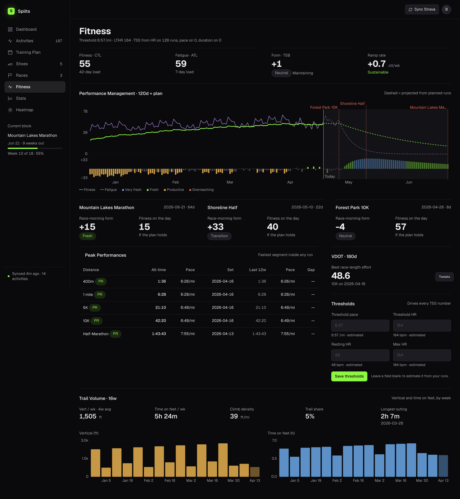
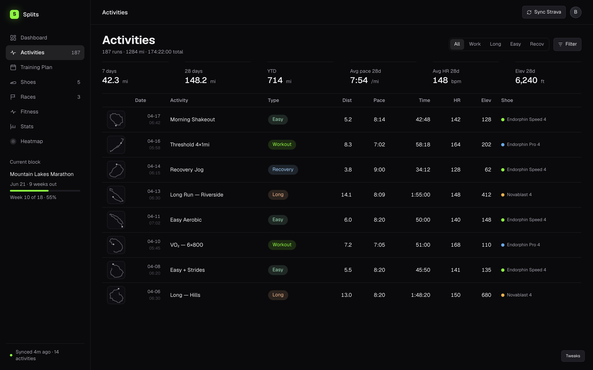
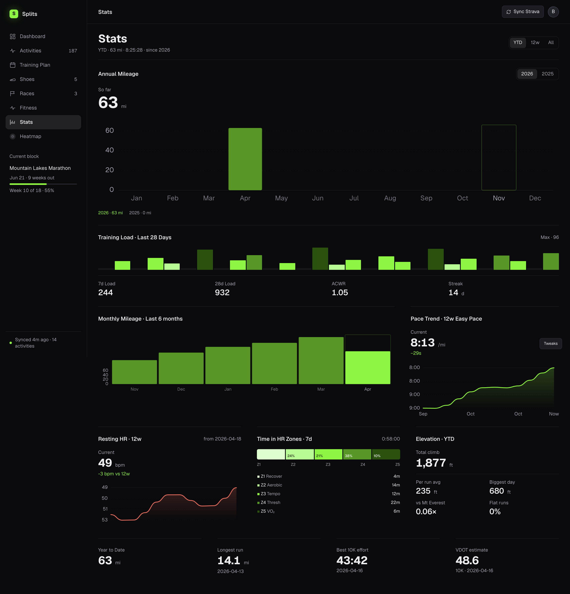
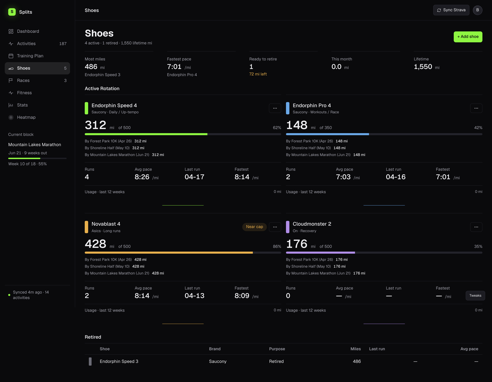
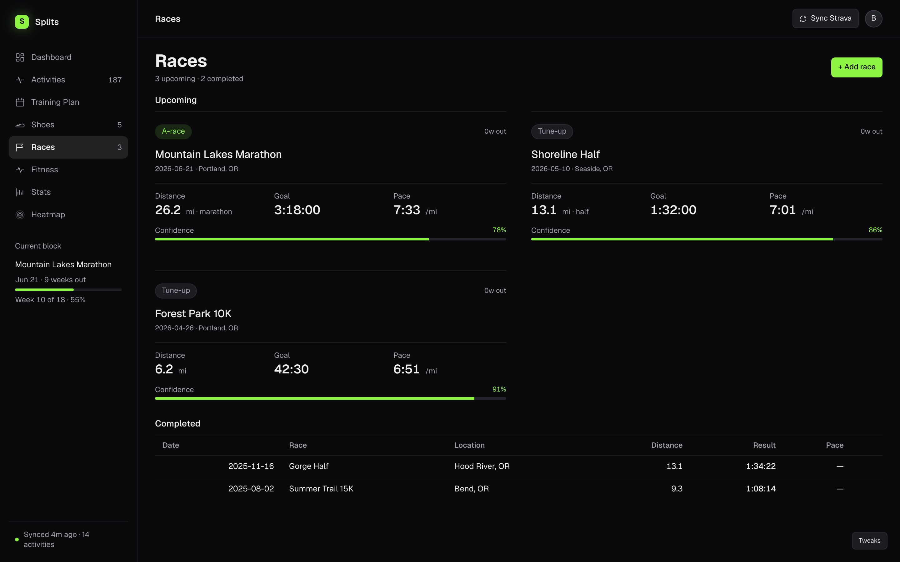

# Splits

A self-hosted run tracker for you and a few friends. It pulls runs from Strava, tracks them against a training block you upload as a CSV, and shows load, fitness, shoes and races on a dark-mode dashboard.

- **Training plans:** upload a block as a CSV and every run is matched to its planned workout.
- **Fitness:** fitness / fatigue / form (CTL / ATL / TSB), race-day projection, peak performances, VDOT, trail volume.
- **Shoes:** mileage per shoe, retirement caps, and runs split across several shoes.
- **Races:** upcoming and completed, with course maps and goal pace.
- **Optional:** WHOOP recovery / HRV, Mapbox route maps and a heatmap.

It runs on free tiers of Supabase and Vercel. Sign-in is invite-only via a Google email allowlist.

---

## Screenshots

_Mock data. Regenerate with `pnpm dev:mock` + `pnpm screenshots`._

| | |
|---|---|
| **Dashboard**  | **Training plan**  |
| **Activity**  | **Fitness**  |
| **Activities**  | **Stats**  |
| **Shoes**  | **Races**  |

---

## Try it in one minute (no accounts needed)

```bash
pnpm install
pnpm dev:mock        # http://localhost:3001: demo data, no login, no API keys
```

Requires Node 22.6+ and pnpm (`corepack enable`).

---

## Self-hosting

You need three accounts, all free: **Supabase** (database + login), **Google Cloud** (the "Continue with Google" button) and **Strava** (where runs come from). Plan on about 20 minutes.

```bash
cp .env.example .env.local     # fill it in as you go
pnpm check-env                 # tells you exactly what's missing, any time
```

### 1. Supabase

1. Create a project at [supabase.com](https://supabase.com).
2. **Project Settings → API**: copy the URL, `anon` key and `service_role` key into `NEXT_PUBLIC_SUPABASE_URL`, `NEXT_PUBLIC_SUPABASE_ANON_KEY` and `SUPABASE_SERVICE_ROLE_KEY`.
3. **SQL Editor**: run every file in `supabase/migrations/`, in order. The quickest way is to paste them all in at once:
   ```bash
   cat supabase/migrations/*.sql | pbcopy     # macOS; or open and copy them in order
   ```
   (Or, with the Supabase CLI: `supabase link --project-ref <ref> && supabase db push`.)

### 2. Google sign-in

1. In [Google Cloud Console](https://console.cloud.google.com): **APIs & Services → OAuth consent screen**, choose External. Either publish it (*In production*; with only name and email scopes, no verification is needed) or keep it in *Testing* and add every invited email as a test user.
2. **Credentials → Create OAuth client ID → Web application.** Set the authorized redirect URI to `https://<your-project-ref>.supabase.co/auth/v1/callback`.
3. In Supabase: **Authentication → Providers → Google**, then paste in the client ID and secret.
4. In Supabase: **Authentication → URL Configuration**: set the Site URL to your app URL and add `http://localhost:3000/**` (plus your prod URL) to the redirect URLs.
5. Set `ALLOWED_EMAILS` to your Google email.

### 3. Strava

1. Create an app at [strava.com/settings/api](https://www.strava.com/settings/api).
2. Set **Authorization Callback Domain** to the bare hostname only: `localhost` for dev, `splits.example.com` for prod.
3. Copy the client ID and secret into `STRAVA_CLIENT_ID` and `STRAVA_CLIENT_SECRET`.
4. Set `STRAVA_WEBHOOK_VERIFY_TOKEN=$(openssl rand -hex 16)` and `CRON_SECRET=$(openssl rand -hex 32)`.

### 4. Run it

```bash
pnpm check-env      # should say "All set"
pnpm dev            # http://localhost:3000
```

Sign in with Google, click **Connect Strava**, and the last 2 years of your runs import in the background. Then upload a training block on the **Training Plan** page (see [CSV format](#training-blocks-csv)).

### 5. Deploy (Vercel)

1. Import the repo in Vercel and add every variable from `.env.local` **except** `DEV_AUTH_BYPASS`. Set `NEXT_PUBLIC_APP_URL` to your prod URL.
2. Update the Strava callback domain and the Supabase redirect URLs to your prod domain.
3. Register the Strava webhook once (this is what makes new runs appear automatically):
   ```bash
   node scripts/register-strava-webhook.mjs        # --delete to tear down and re-register
   ```

The nightly crons in `vercel.json` also reconcile the last 14 days and match runs to the plan. Webhooks don't fire for local dev, so use the **Sync Strava** button there.

### Optional extras

| Feature | Variables | Notes |
|---|---|---|
| Route maps + heatmap | `NEXT_PUBLIC_MAPBOX_TOKEN` | Default public token from [account.mapbox.com](https://account.mapbox.com). Restrict it to your domain. |
| WHOOP recovery / HRV | `WHOOP_CLIENT_ID`, `WHOOP_CLIENT_SECRET` | App at [developer-dashboard.whoop.com](https://developer-dashboard.whoop.com). Redirect URI `<app-url>/api/whoop/auth/callback`. Scopes: `read:recovery read:sleep read:cycles read:workout read:profile read:body_measurement offline`. Connect from `/connect-strava`. |
| Timezone | `APP_TIMEZONE` | IANA name, e.g. `America/New_York`. Defaults to `America/Los_Angeles`. |

---

## Inviting friends

Add their Google email to `ALLOWED_EMAILS` (comma-separated) and redeploy:

```bash
ALLOWED_EMAILS=you@gmail.com,friend@gmail.com
```

- **The first email is the owner.** Only the owner's first Strava connect imports past runs. Invited people start fresh, and Splits tracks their runs from the moment they connect.
- **Raise your Strava app's athlete limit.** New Strava API apps allow only 1 connected athlete. Request more on your app's settings page before inviting anyone.
- **Google:** if your OAuth consent screen is in *Testing*, add them as test users. If it's *In production*, nothing to do, since `ALLOWED_EMAILS` is the gate.
- **They don't need Strava already.** If they use COROS, Garmin, Apple Watch or similar, they can create a free Strava account and turn on Strava sync in their watch's app. Runs then flow through automatically.
- Everyone's data is isolated by Postgres row-level security keyed to their login.

---

## Training blocks (CSV)

On **Training Plan**, click **Upload block (CSV)**. Give the block a name and, optionally, a goal race with a target time. Start from [`public/plan-template.csv`](public/plan-template.csv), which you can also download from that dialog. Google Sheets works fine: File → Download → CSV.

```csv
date,workout_type,distance_mi,pace_per_mi,description
2027-01-04,easy,5,9:30,Easy 5 — conversational
2027-01-05,rest,,,
2027-01-06,workout,7,7:45,"2mi warmup, 3x1mi @ threshold w/ 2:00 jog, cooldown"
2027-01-09,long,12,9:15,Long run — last 2mi at goal pace
```

| Column | Required | Format |
|---|---|---|
| `date` | yes | `YYYY-MM-DD` |
| `workout_type` | yes | `easy`, `tempo`, `interval`, `long`, `recovery`, `rest`, `race` or `workout` |
| `distance_mi` | no | miles, e.g. `6` or `6.5` |
| `pace_per_mi` | no | target pace per mile, e.g. `8:30` |
| `description` | no | free text. Wrap it in quotes if it contains commas. |

The header row is optional, and blank lines and `#` comments are ignored. If any row is invalid, nothing is imported and every bad line is listed so you can fix it and re-upload. Runs are matched to planned workouts by date each night, or straight away with **Sync Strava**.

**Editing a block:** edit your sheet, then click **Update block** and upload it again. Today onward is replaced by the file. Days before today stay as recorded, including which runs completed them, so re-uploading the whole sheet is fine. The same dialog can rename the block, change or remove its goal race, upload a separate new block instead, or **Delete block** (runs and races aren't affected).

---

## Stack

- **Next.js 16** App Router, **React 19**, **Tailwind 4**, TypeScript strict. Server components throughout.
- **Supabase**: Postgres, Google auth, row-level security.
- **Strava** REST + webhooks; **WHOOP** REST (optional).
- **Vercel** Hobby tier, including cron.
- Hand-drawn SVG charts (no chart library); **Mapbox GL JS** for maps.
- **Anthropic** for per-run analysis: the API route and schema exist, but nothing in the UI triggers it yet.

---

## Project layout

```
/app
  /(app)                 signed-in shell (sidebar + topbar)
    page.tsx             dashboard
    /activities          list + detail (lazy-fetched streams, shoe splits)
    /plan                block view, CSV upload (actions.ts, import-plan.tsx)
    /shoes /races /fitness /stats /heatmap
  /(auth)                login, connect-strava
  /api
    /auth                Google OAuth callback + email allowlist
    /strava              OAuth, webhook, manual sync, disconnect
    /whoop               OAuth
    /activities/[id]     streams, AI analysis
    /cron                nightly sync + plan matching
/components              ui, charts, maps, shell, fluid (motion), gear
/lib
  /auth                  allowlist (ALLOWED_EMAILS), current athlete, history cutoff
  /supabase              clients + queries.ts (every page reads through this; swaps to /mock in demo mode)
  /strava /whoop         token-aware clients + sync
  /plan                  CSV parser, activity ↔ planned-run matcher
  /fitness               TSS, PMC, best efforts / VDOT, GAP, thresholds (pure, unit-tested)
  /gear                  shoe colors, multi-shoe segments
  /mock                  demo data for `pnpm dev:mock`
  /utils                 units, TZ-aware dates
/supabase/migrations     run in order
/scripts                 see below
/public/plan-template.csv
proxy.ts                 session gate (Next 16 "proxy", formerly middleware)
vercel.json              cron schedule
```

### Scripts

All scripts read `.env.local` and run from the repo root with `node scripts/<name>.mjs`.

| Script | What it does |
|---|---|
| `check-env.mjs` (`pnpm check-env`) | Setup doctor: env vars, Supabase connection, migrations |
| `register-strava-webhook.mjs` | One-time webhook registration after the first deploy |
| `resync.mjs [days]` | Re-pull recent activities + gear after edits in Strava |
| `backfill-athlete.mjs <email> [years]` | Import an invited athlete's full Strava history (clears their history cutoff) |
| `backfill-polylines.mjs` | Fill in all route maps at once. Sync otherwise does this 50 activities per run. |
| `whoop-backfill.mjs [days]` | Manual WHOOP backfill |
| `import-race-course-gpx.mjs`, `fetch-race-courses.mjs` | Attach a course map to a race |
| `screenshot.mjs` (`pnpm screenshots`) | README screenshots from the mock server |
| `test-*.mjs` (`pnpm test`) | Unit tests |
| `check-*.mjs`, `inspect.mjs`, `test-stream-fetch.mjs` | Diagnostics |
| `coros-push.mjs` | Push planned runs to the COROS calendar via its **unofficial** API (needs `COROS_*`) |

The rest (`seed-*`, `add-*`, `race-update*`, `roosters-*`, `migrate-week18`, `split-roosters-block`, `fix-roosters-gear`, `backfill-expected-gear`) are the author's one-off data edits, kept as examples of scripting against the schema. They hard-code the author's races and dates.

---

## How the data flows

```
Strava ─OAuth(once)──▶  strava_tokens
       ─webhook──────▶  /api/strava/webhook ──▶ activities (upsert)
       ─REST─────────▶  owner's 2-year import on first connect ──▶ activities
                        nightly cron / Sync button: last 14 days + details
                        /activities/[id]: streams (lazy) ──▶ activity_streams

WHOOP  ─OAuth(once)──▶  whoop_tokens ──▶ recovery / cycles / workouts
                                          (workouts matched to runs ±10 min)

Every page: server component → Supabase (row-level security) → render
```

The browser never calls Strava or WHOOP. All third-party work happens in API routes and cron jobs, and pages only read from Supabase.

---

## Architecture notes

- **`lib/supabase/queries.ts`** is the single read interface. Add new queries there, not in page files. In demo mode it swaps in `lib/mock`.
- **`createServerSupabase()`** uses the caller's cookies, so row-level security applies. **`createServiceRoleSupabase()`** bypasses it. Use it only in webhooks, OAuth callbacks, cron, scripts and server actions, and **always filter by the athlete from `getCurrentAthleteId()`**. Never import it into a client component.
- **History cutoff:** `athletes.history_from` is null for the owner (full history) and the connect time for invited users. `lib/auth/history.ts` enforces it inside the Strava and WHOOP sync functions, so the webhook, cron, Sync button and backfill all respect it. `scripts/backfill-athlete.mjs` clears it to import someone's history after all.
- **Sports:** everyone syncs runs. An athlete with an Ironman / 70.3 race (`races.race_type`) also syncs swims and rides, and gets the Triathlon page. Every running view (mileage, pace, shoes, fitness, plan matching) filters on `type = 'Run'`; only the Activities log and the Triathlon page show other sports.
- **Dates are TZ-sensitive.** Use `lib/utils/dates.ts` (`todayLocalISO`, `addDaysISO`, …), never `new Date().toISOString()` for "today".
- **Polylines:** Strava's list endpoint returns an empty `summary_polyline`, so sync fills it from the detail endpoint, 50 activities per run.
- **Workout labels** (Easy / Long / Workout …) come from the matched planned run, falling back to keywords in the activity name.
- **WHOOP** mixes API versions (cycles v1, recovery + workouts v2 with UUID IDs), and has no per-second HR. HR curves need HR in Strava.
- **Theme:** the Tweaks panel stores the accent color in `localStorage["splits.accent"]`, and an inline script applies it before first paint.

---

## Gotchas

- **Strava rate limits are per app, not per user:** 100 requests / 15 min and 1,000 / day, shared by everyone on your instance.
- **One Strava callback domain per app.** Swap between `localhost` and prod, or use two Strava apps.
- **`DEV_AUTH_BYPASS=true` sees every athlete.** It swaps in the service-role client, so with more than one athlete in the database, local pages mix everyone's data. With friends on the same database, sign in with Google locally instead. Never set it in production.
- **Missing auth config fails closed in production.** If Supabase or `ALLOWED_EMAILS` isn't set, the app returns 503 instead of running unauthenticated.
- **Webhook handlers return immediately.** Strava wants a 200 within about 2 seconds, so no slow work happens in the request path. Missed events get picked up by the nightly reconcile.

---

## Roadmap

- Create / edit races, shoes and planned runs in the UI (today: CSV upload for plans, a form for shoes, scripts for the rest)
- Trigger AI run analysis from the UI (the API route and schema exist)
- Settings page (HR zones, units, Strava disconnect)
- Mobile layout (currently desktop-first)
- Apple Health import for HR streams (e.g. via Health Auto Export → `/api/health/import`)

---

## License

[MIT](LICENSE)
